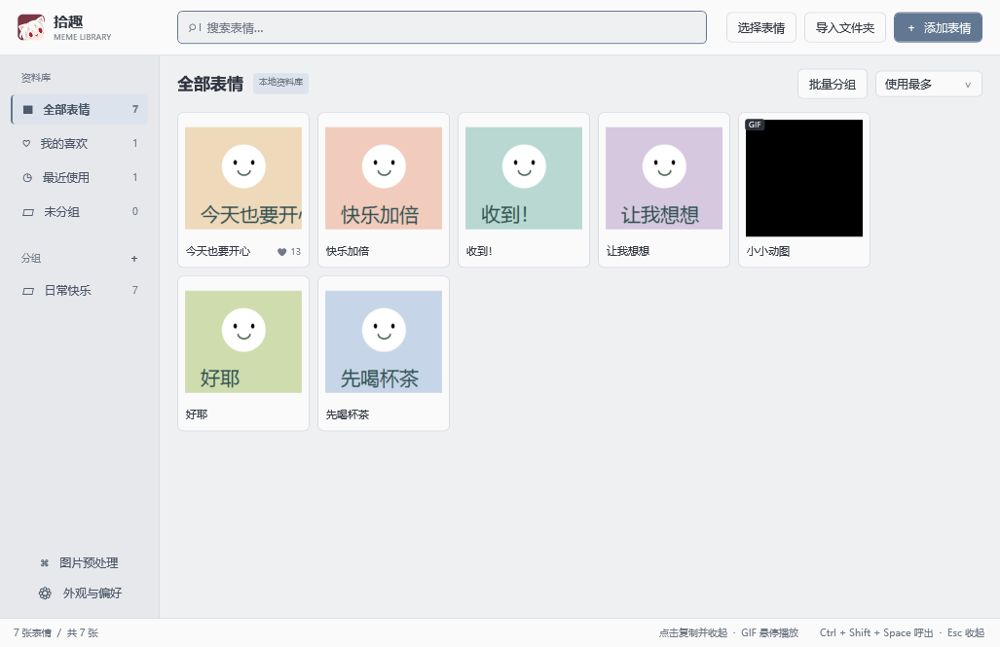
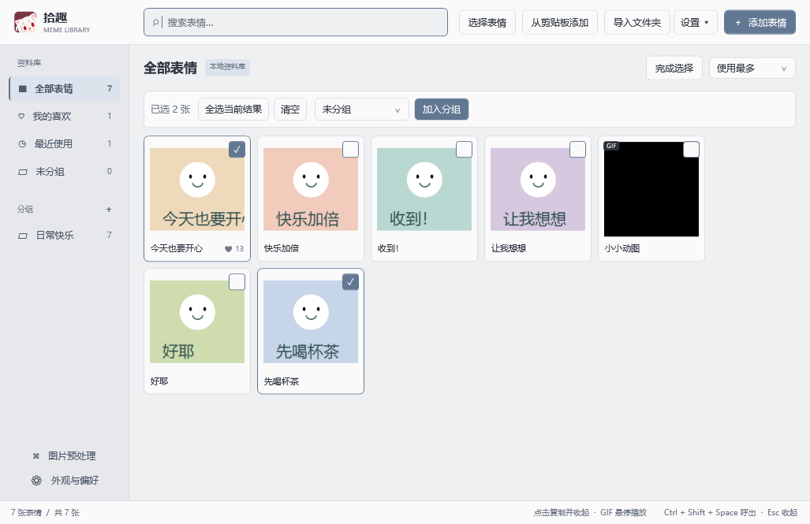
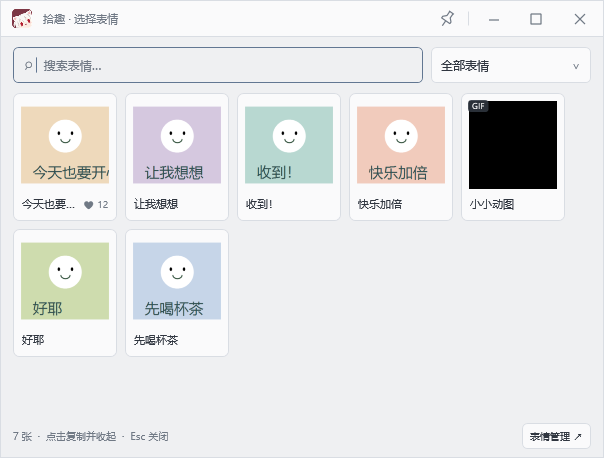
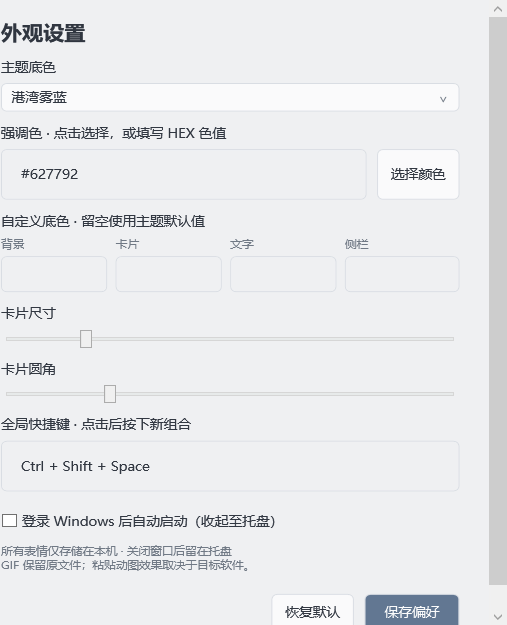
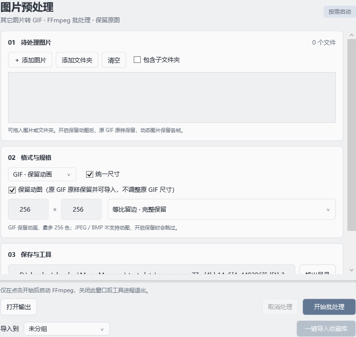

<div align="center">


# 拾趣 · MemeManager

**把喜欢的表情收好，在需要时一键找到。**

Windows 原生表情收藏夹 · 独立快捷选择器 · 保留动图 · 按需图片预处理


[界面预览](#界面预览) · [功能](#把收藏到使用连起来) · [快速开始](#快速开始) · [技术栈](#技术栈) · [使用手册](docs/usage.md)



<sub>港湾雾蓝 / 紧凑网格 / 自定义主题</sub>

</div>

## 把收藏到使用连起来

| 收藏与整理 | 呼出与使用 | 处理与定制 |
| :--- | :--- | :--- |
| 多选、拖放、剪贴板、文件夹导入，可按子文件夹自动分组 | `Ctrl + Shift + Space` 独立选择器 | 独立 FFmpeg 批处理工具，调用时才运行 |
| 分组、批量分组、名称搜索、SHA-256 去重 | 按使用频率或最近使用查找 | 其它格式批量转 GIF，支持保留动图 |
| 保存 GIF 原文件，悬停播放缩略图 | 点击复制到剪贴板，选择器自动收起 | 统一尺寸，处理完成一键导入分组 |
| 图片与资料库保存在非 C 盘 | 托盘驻留，可选登录 Windows 自启 | 四款主题、导入背景图片、自定义配色与卡片样式 |

复制后在聊天窗口按 `Ctrl + V` 粘贴。支持文件粘贴的应用可接收原始 GIF；只接收位图的应用会得到静态首帧。

## 界面预览

<details>
<summary><strong>展开查看 · 批量分组</strong></summary>

<br />


点击「批量分组」进入选择模式，可逐张勾选或全选当前搜索结果，选择分组后点击「加入分组」。搜索、分组切换和滚动保留勾选，支持统一移回未分组。

</details>

<table>
  <tr>
    <td align="center" width="50%"><strong>快捷选择</strong><br /><sub>只保留找图和复制需要的操作</sub></td>
    <td align="center" width="50%"><strong>外观与偏好</strong><br /><sub>独立设置窗口，按自己的习惯调整</sub></td>
  </tr>
  <tr>
    <td align="center"></td>
    <td align="center"></td>
  </tr>
</table>

<details>
<summary><strong>展开查看 · 图片预处理</strong></summary>

<br />


从 Manager 左下角「图片预处理」进入，添加文件或文件夹，选择格式与规格。处理完成后，可直接导入指定分组。原有 GIF 在开启「保留动图」时原样复制；动态 WebP / APNG 转 GIF 保留帧和播放间隔。

工具使用独立进程，关闭后退出；FFmpeg 仅在开始处理后运行。没有使用预处理时，主程序不会加载该模块的窗口、队列或处理进程。

</details>

## 快速开始

将源码放在 **D 盘或其它非 C 盘**，在 Windows PowerShell 中运行：

```powershell
git clone https://github.com/Jax367/MemeMangager.git MemeManager
cd MemeManager
.\build.ps1
.\dist\non-c\MemeManager.exe
```

使用 Windows 自带的 .NET Framework C# 编译器，无需安装 .NET SDK 或下载 NuGet 包。运行需要 .NET Framework 4.8，构建结果位于 `dist/non-c`，请保留整个目录。

**预处理需要另外安装 FFmpeg。** 工具会查找程序目录、`tools` 子目录和 `PATH`，也可手动选择 `ffmpeg.exe`。保留动态 WebP 需要 FFmpeg 支持动画 WebP 解码。

更新前请从托盘退出旧版。资料库默认保存在项目的 `data` 目录，可通过 `storage-path.txt` 或 `--data-dir` 指定其它非 C 盘位置。

## 技术栈

| 层次 | 技术 | 用途 |
| :--- | :--- | :--- |
| 桌面界面 | **C# 5.0 · WPF · .NET Framework 4.8** | 原生窗口、主题、图片网格与独立选择器 |
| 系统集成 | **Win32 / Shell API** | 全局快捷键、托盘、剪贴板、目录选择与窗口消息 |
| 媒体处理 | **FFmpeg · 独立进程** | 格式转换、动画保留、缩放、裁切与调色板处理 |
| 本地存储 | **JSON · 文件系统 · SHA-256** | 资料库、使用记录、偏好、内容去重与原子保存 |
| 图片加载 | **WPF / WIC · 磁盘缩略图缓存** | 按视口创建卡片，限制缓存，隐藏后释放图片引用 |
| 构建与验证 | **PowerShell · 系统 csc.exe** | 无 NuGet 构建、功能检查与内存对比 |

应用不依赖 WebView、Electron 或数据库服务。WPF 仍有运行时开销；程序体积不代表运行内存，测量条件与结果见 [性能记录](docs/performance.md)。

## 开发与文档

```powershell
.\test.ps1
.\test-preprocess.ps1  # 需要本机 FFmpeg
```

验证使用独立测试资料库，覆盖导入去重、窗口生命周期、持久化、图片转换、动图帧数与播放间隔等行为。

| 文档 | 内容 |
| :--- | :--- |
| [完整使用手册](docs/usage.md) | 窗口操作、格式支持、批处理、一键导入、构建与验证 |
| [性能记录](docs/performance.md) | 内存测量、优化方式与复测方法 |
| [图标资源说明](assets/README.md) | 图标源文件与各尺寸资源 |

<div align="center">

### 来过拾趣的你


<sub>计数服务由 <a href="https://github.com/journey-ad/Moe-Counter">Moe Counter</a> 提供。图片请求计数受 GitHub 缓存影响，不等同于独立访客数；仅用于仓库首页。</sub>

</div>
